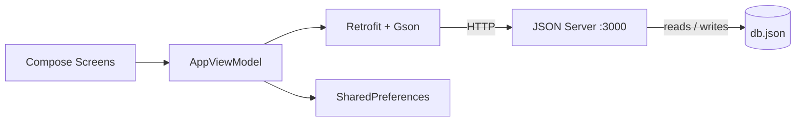

# 🌾 KisanMandi – Crop Prices & Produce Marketplace

KisanMandi is an Android app for Sindh farmers to track wholesale crop prices, compare mandis, set price alerts, estimate profit, and sell produce directly to buyers.

Built for **AWS Cloud Club MUET – HacktoberFest 3.0** (Web/App track).

---

## ✨ Features

| Module | What it does |
|---|---|
| Sign-up & Roles | First launch collects name, phone, email, district and role. Farmers get 4 tabs (Prices, Market, Alerts, My Listings); buyers get 2 (Prices, Market). |
| Price Discovery | Today's prices per market, crop search, category filter, daily change in Rs and %, pull-to-refresh. |
| Crop Trends | 14-day line chart, min / max / average, all markets compared with the best place to sell highlighted. |
| Price Alerts | Crop + market + Above/Below + target price. On/off toggle, edit, delete. Triggered count shown as a badge on the Alerts tab. |
| Marketplace | Validated listing form, search, filter by crop / district / grade, sort by newest or price. Below / At / Above market label (±5% = At market). Call & WhatsApp buttons. |
| Ownership | Only the owner can edit, mark Sold, or delete a listing. |
| Profit Calculator | Revenue, total cost, profit/loss and margin %, with a what-if slider from -20% to +20%. |

---

## 🛠 Tech Stack

| Layer | Technology |
|---|---|
| Language | Kotlin |
| UI | Jetpack Compose, Material 3 |
| Architecture | Single-activity, ViewModel + Compose state |
| Networking | Retrofit 2 + Gson converter |
| Local storage | SharedPreferences (logged-in user only) |
| Mock backend | JSON Server 0.17.4 (Node.js) |
| Charts | Custom Canvas line chart (no library) |
| Build | Gradle (Kotlin DSL) |

---

## 🔄 Workflow / Architecture



1. A screen asks the **ViewModel** for data or calls an action (e.g. save listing).
2. The ViewModel calls the **API** through Retrofit.
3. **JSON Server** reads or updates `db.json` and returns JSON.
4. The ViewModel updates its state, and Compose redraws the screens automatically.

---

## 📁 Folder Structure

```
KisanMandi/
├── app/
│   ├── build.gradle.kts              # App dependencies (Retrofit, Gson, ViewModel, Icons)
│   └── src/main/
│       ├── AndroidManifest.xml       # INTERNET permission + cleartext HTTP
│       └── java/com/example/kisanmandi/
│           ├── Data.kt               # Models, API interface, Retrofit setup (BASE_URL)
│           ├── AppViewModel.kt       # Data loading/saving, alert check, market label, ownership check
│           ├── MainActivity.kt       # App start, theme, navigation, sign-up, home tabs, logout dialog
│           ├── Components.kt         # Shared UI: cards, search bar, dropdowns, chart, product card
│           ├── PriceScreens.kt       # Prices tab + crop detail (chart, market comparison)
│           ├── ListingScreens.kt     # Marketplace, My Listings, listing details, listing form
│           └── ToolScreens.kt        # Price alerts + profit calculator
├── db.json                           # Mock API seed data
├── build.gradle.kts
├── settings.gradle.kts
└── README.md
```

---

## 🗃 Database Structure

| Collection | Fields |
|---|---|
| users | id, name, phone, email, district, role (Farmer/Buyer) |
| crops | id, name, category |
| markets | id, name, district |
| prices | id, crop_id, market_id, date, price |
| listings | id, user_id, crop_id, quantity, asking_price, district, grade, available_from, status, phone, created_at |
| alerts | id, user_id, crop_id, market_id, condition (Above/Below), target_price, active_status |

**Seed data (all fictional):** 8 crops in 4 categories, 3 markets (Hyderabad, Sukkur, Larkana), 14 days of prices for every crop–market pair (336 rows), 6 users, 12 listings, 5 alerts.

---

## 🌐 API Endpoints

| Method | Endpoint | Used for |
|---|---|---|
| GET | `/users`, `/crops`, `/markets`, `/prices`, `/listings`, `/alerts` | Load data |
| POST | `/users` | Register |
| POST | `/listings` | New listing |
| PUT | `/listings/{id}` | Edit / mark sold |
| DELETE | `/listings/{id}` | Delete listing |
| POST | `/alerts` | New alert |
| PUT | `/alerts/{id}` | Edit / toggle alert |
| DELETE | `/alerts/{id}` | Delete alert |

---

## 🚀 How to Run

**1. Start the mock API**
```bash
sudo apt install nodejs npm
sudo npm install -g json-server@0.17.4
json-server --watch db.json --host 0.0.0.0
```
Check it at `http://localhost:3000/crops`.

**2. Set `BASE_URL` in `Data.kt`**

| Device | BASE_URL |
|---|---|
| Emulator | `http://10.0.2.2:3000/` |
| Phone via USB | `http://127.0.0.1:3000/` + run `adb reverse tcp:3000 tcp:3000` |
| Phone on same Wi-Fi | `http://<laptop-ip>:3000/` |

**3. Run** the app from Android Studio.

---

## 👥 Team

| Name | Role |
|---|---|
| Faizan Palari | Android Developer |
| Abdul Aziz | Control Json File|
